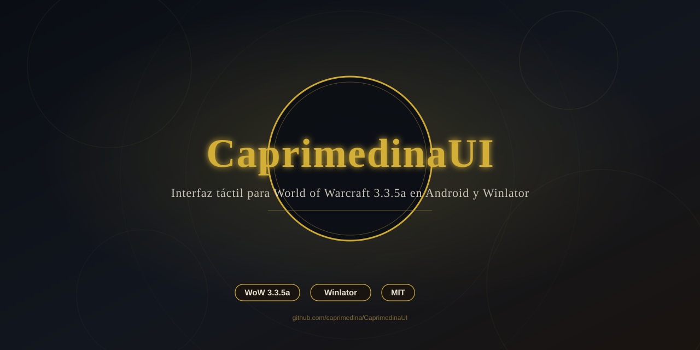
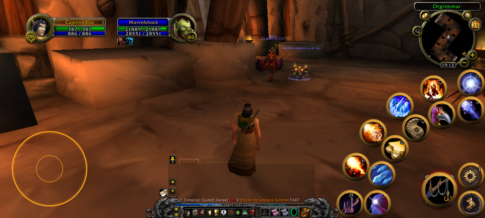
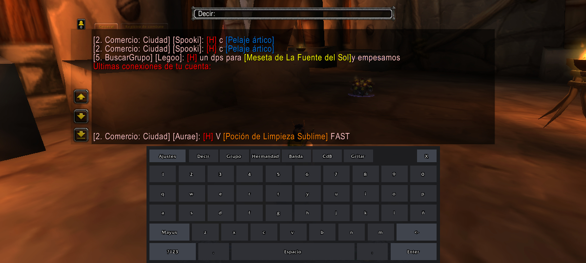
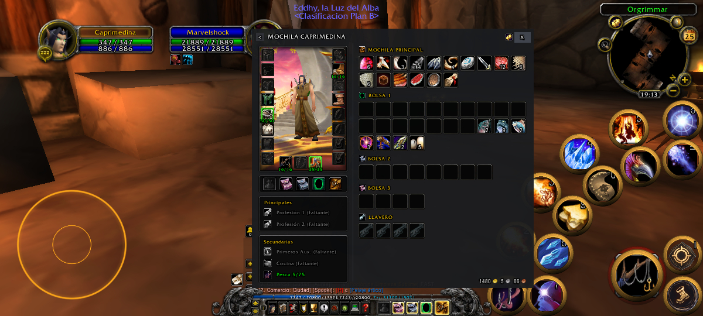
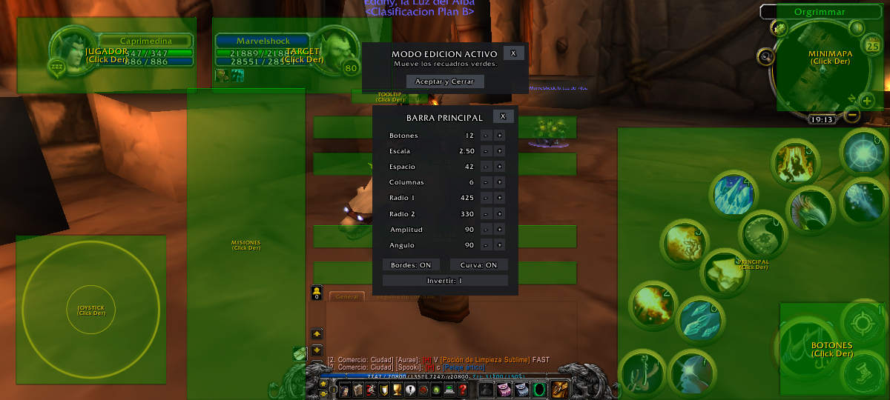
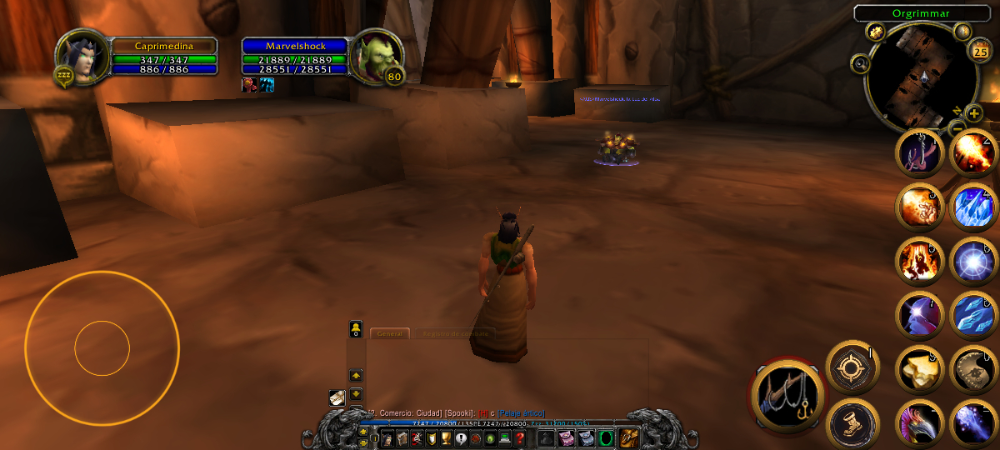
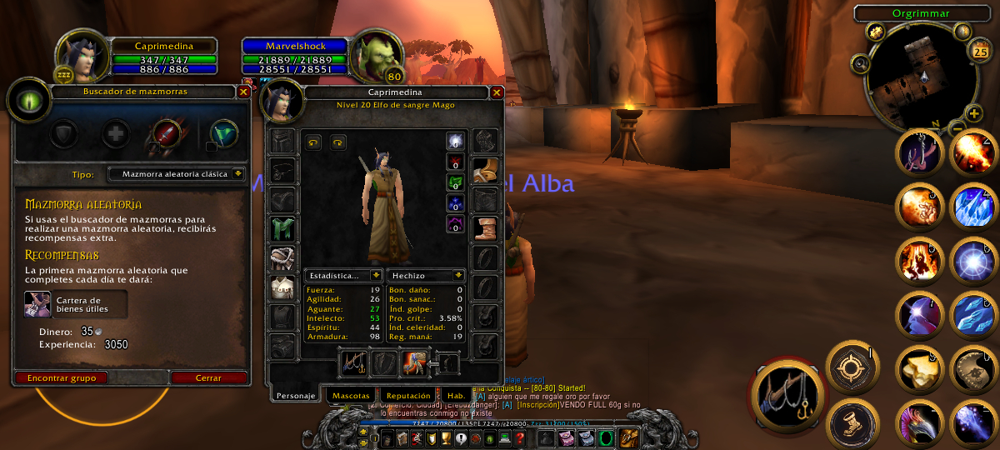
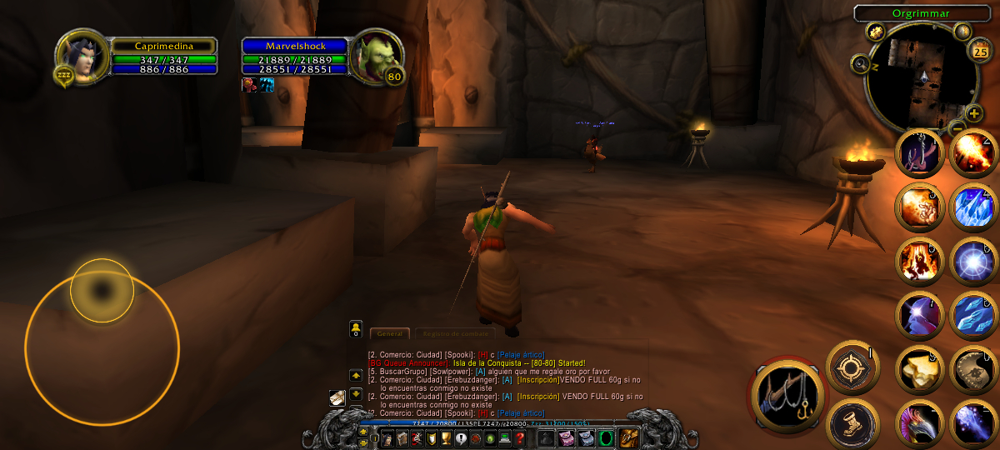
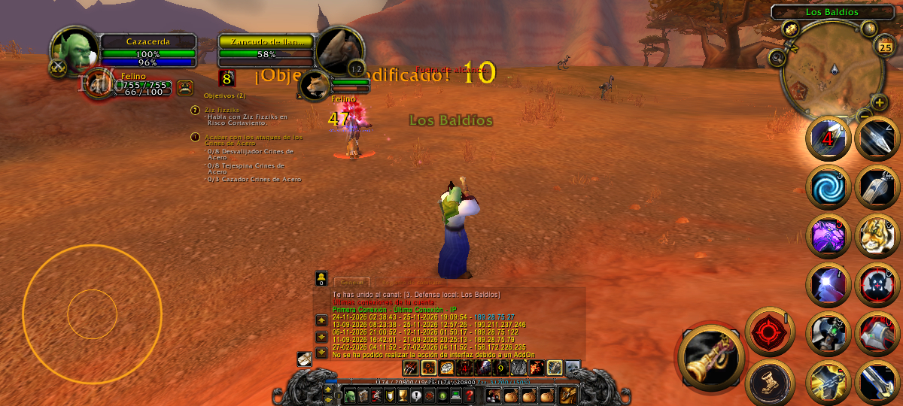

<div align="center">

# CaprimedinaUI

**Interfaz táctil para World of Warcraft 3.3.5a (Wrath of the Lich King) pensada para jugar en Android con Winlator.**


</div>

<p align="center">
  
</p>

---

CaprimedinaUI reemplaza y amplía la interfaz original de Wrath of the Lich King para que sea cómoda con el dedo: botones grandes, joystick virtual, teclado en pantalla, ventanas que se ajustan solas y un HUD limpio. Está desarrollada y probada en **Android + Winlator**, aunque funciona igual en Windows.

- Sin librerías externas ni dependencias.
- Solo Lua, compatible con el cliente **3.3.5a (build 12340)**.
- Todos los ajustes se guardan por cuenta en `SavedVariables`.

## Índice

- [Características](#-características)
- [Capturas](#-capturas)
- [Instalación](#-instalación)
- [Uso rápido](#-uso-rápido)
- [Comandos](#-comandos)
- [Configuración](#-configuración)
- [Estructura del proyecto](#-estructura-del-proyecto)
- [Compatibilidad](#-compatibilidad)
- [Solución de problemas](#-solución-de-problemas)
- [Contribuir](#-contribuir)
- [Créditos](#-créditos)
- [Licencia](#-licencia)

## ✨ Características

### Controles táctiles

- **Botones de acción grandes** (Atacar, Objetivo y Saltar) con brillo inmediato al pulsar y sin retardo al soltar.
- **Joystick virtual** con anillo dorado; el círculo interior se agranda y se ilumina al moverte, como un dpad nativo de Android.
- **Teclado virtual en pantalla** que aparece al escribir en el chat.
- **SmartClick** y cámara automática para jugar sin ratón.

### Ventanas legibles

- **Ventanas Grandes**: escala automática de las ventanas de Blizzard (Personaje, Hechizos, Talentos, Buscador de mazmorras, Subasta, Comercio, etc.) para que quepan en pantalla y sean clicables con el dedo.
- Escala máxima configurable (2.2x por defecto) y tamaño coherente entre ventanas.
- El **mapa del mundo** se deja en su tamaño original para que no se salga de la pantalla.

### HUD e interfaz

- **Bolsas y banco propios**, con escala, columnas, títulos y bloqueo independientes.
- **Barras de acción curvas** con asignación de teclas integrada.
- **Bolitas de Jugador y Objetivo** rediseñadas, arrastrables y escalables (arrancan a 1.50 para pantallas pequeñas).
- **Minimapa** escalable; los buffs y debuffs del jugador crecen y se mueven con él.
- **Chat** integrado y protegido contra arrastres accidentales.
- **Modo edición** con anclajes visibles para colocar cada elemento.
- **Escala de UI** integrada, sin salir al menú de vídeo.
- **Modo rendimiento** con un comando para equipos modestos.

## 📸 Capturas

Capturas reales del addon en juego (cliente 3.3.5a en Winlator/Android).

| | |
|---|---|
|  |  |
|  |  |
|  |  |
|  |  |


## 📦 Instalación

1. Descarga la última versión desde la pestaña **Releases** o el ZIP del proyecto.
2. Copia la carpeta `CaprimedinaUI` dentro de `Interface/AddOns/`.
3. Comprueba que la ruta quede así:

   ```
   World of Warcraft 3.3.5a/
   └── Interface/
       └── AddOns/
           └── CaprimedinaUI/
               ├── CaprimedinaUI.toc
               ├── core.lua
               └── ...
   ```

4. Inicia el juego (o escribe `/reload` si ya estabas dentro) y activa el addon en la pantalla de selección de personaje.

> **Winlator / Android:** copia la carpeta en el mismo directorio del cliente dentro del contenedor y arranca el juego normalmente. No requiere configuración adicional.

## 🚀 Uso rápido

- **Botón del minimapa:** un clic abre el menú de configuración; arrástralo para colocarlo donde quieras.
- **Modo edición:** `/capri` (o `/cui`) muestra los anclajes en verde. Arrastra cada marco para colocarlo y vuelve a escribir el comando para salir.
- **Ajustes por elemento:** en modo edición, algunos elementos abren su propio menú con **clic derecho** (por ejemplo, el joystick).
- Los cambios se guardan automáticamente en:

  ```
  WTF/Account/<CUENTA>/SavedVariables/CaprimedinaUI.lua
  ```

## ⌨️ Comandos

| Comando | Descripción |
| --- | --- |
| `/capri` · `/cui` | Activa o desactiva el modo edición con anclajes visibles. |
| `/botones` | Abre los ajustes de los botones de acción. |
| `/botones reset` | Restablece los botones de acción. |
| `/dpad` | Muestra u oculta el joystick virtual. |
| `/perf` | Aplica el modo rendimiento (dibujado, sombras y FPS limitados). |
| `/capribind` | Abre el asignador de teclas de las barras del addon. |
| `/capribarra reset` | Restablece la barra de acción principal. |
| `/escala` · `/uiscale` | Abre el ajuste de escala de la interfaz. |
| `/sc` · `/smartclick` | Menú de SmartClick y cámara automática. |
| `/vkb` | Activa o desactiva el teclado virtual. |
| `/ventanas` | Activa o desactiva el escalado automático de ventanas. |
| `/ventanas on` · `off` | Fuerza el escalado de ventanas. |
| `/ventanas max <n>` | Cambia la escala máxima (por defecto `2.2`). |
| `/ventanas list` | Lista las ventanas administradas y su escala actual. |
| `/ventanas dump` | Guarda un diagnóstico en `SavedVariables`. |
| `/ventanas reset` | Restablece el escalado de ventanas. |
| `/capframe` | Diagnóstico: muestra el nombre del frame bajo el cursor. |
| `/capdock` | Diagnóstico del estado del chat. |

## ⚙️ Configuración

Los valores se guardan en `CaprimedinaUIDB` (por cuenta) y `SmartClickDB` (por personaje). Los más útiles:

| Clave | Por defecto | Descripción |
| --- | --- | --- |
| `enableBars` | `true` | Interfaz y barras del addon. |
| `enableBags` | `true` | Bolsas y banco propios. |
| `enableChat` | `true` | Mejoras del chat. |
| `enableVida` | `true` | Texto de vida/maná con porcentaje en combate. |
| `enableVentanas` | `true` | Escalado automático de ventanas. |
| `ventanasScale` | `2.2` | Escala máxima de las ventanas. |
| `playerScale` | `1.50` | Escala de la bola del jugador. |
| `targetScale` | `1.50` | Escala de la bola del objetivo. |
| `minimapScale` | `1.0` | Escala del minimapa (los buffs la siguen). |
| `dpadScale` | `1.0` | Escala del joystick. |
| `dpadAlpha` | `0.3` | Opacidad del joystick. |

## 🧩 Estructura del proyecto

```
CaprimedinaUI/
├── CaprimedinaUI.toc      # Metadatos y orden de carga
├── core.lua               # Utilidades, base de datos y skin compartido
├── ui.lua                 # HUD, anclajes, modo edición, minimapa y bolitas
├── config/
│   └── config.lua         # Menú de configuración y botón del minimapa
├── modulos/
│   ├── barra.lua          # Barras de acción curvas y bindings
│   ├── bag.lua            # Bolsas y banco personalizados
│   ├── chat.lua           # Comportamiento del chat
│   ├── escala.lua         # Escala de interfaz
│   ├── SmartClick.lua     # Clic inteligente y cámara automática
│   ├── teclado.lua        # Teclado virtual
│   ├── ventanas.lua       # Ventanas Grandes (escalado automático)
│   └── vida.lua           # Texto de vida/maná
├── botones/
│   ├── botones.lua        # Botones Atacar / Objetivo / Saltar
│   └── dpad.lua           # Joystick virtual
└── texturas/              # Anillos, discos y brillos (TGA/BLP)
```

## ✅ Compatibilidad

| Cliente | Versión | Interface |
| --- | --- | --- |
| World of Warcraft: Wrath of the Lich King | 3.3.5a (12340) | `30300` |

- Probado en **Android con Winlator** (cliente esES) y en Windows.
- No necesita otros addons ni frameworks.
- Convive con la interfaz original: desactiva solo las partes que reemplaza.

## 🛠️ Solución de problemas

- **No aparece en la lista de addons:** revisa que no haya una carpeta de más (`CaprimedinaUI/CaprimedinaUI/`). La ruta debe terminar en `CaprimedinaUI/CaprimedinaUI.toc`.
- **Una ventana se ve pequeña o enorme:** prueba `/ventanas reset` y luego `/ventanas max 2.2`.
- **Quiero ver qué está pasando con las ventanas:** `/ventanas dump` y revisa `CaprimedinaUI.lua` en `SavedVariables` tras un `/reload`.
- **Restablecer todo:** `/capribarra reset`, `/botones reset`, `/ventanas reset` o borra el archivo de `SavedVariables` con el juego cerrado.
- **Errores de Lua:** activa `/console scriptErrors 1` y adjunta el texto al reportar.

## 🤝 Contribuir

Las ideas y los reportes son bienvenidos. Antes de abrir un cambio, lee [CONTRIBUTING.md](CONTRIBUTING.md) y usa la plantilla de reporte de errores.

## 🙏 Créditos

- **Texturas** de anillos, discos y brillos: creación propia de **Caprimedina**.
- Interfaz base y plantillas: **Blizzard Entertainment**.
- Desarrollo y ajustes para Android: **Caprimedina**.

## 📄 Licencia

El código y las texturas de este proyecto se distribuyen bajo la licencia **MIT**.
Consulta [LICENSE](LICENSE).

---

<div align="center">

Hecho con cariño para jugar WoW 3.3.5a desde el móvil.

</div>
